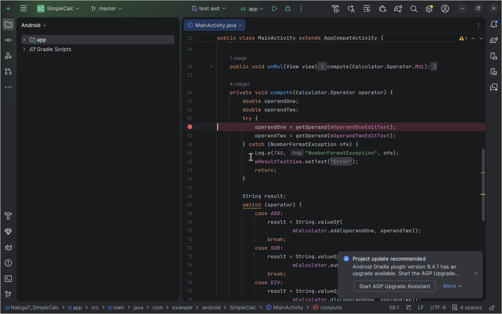
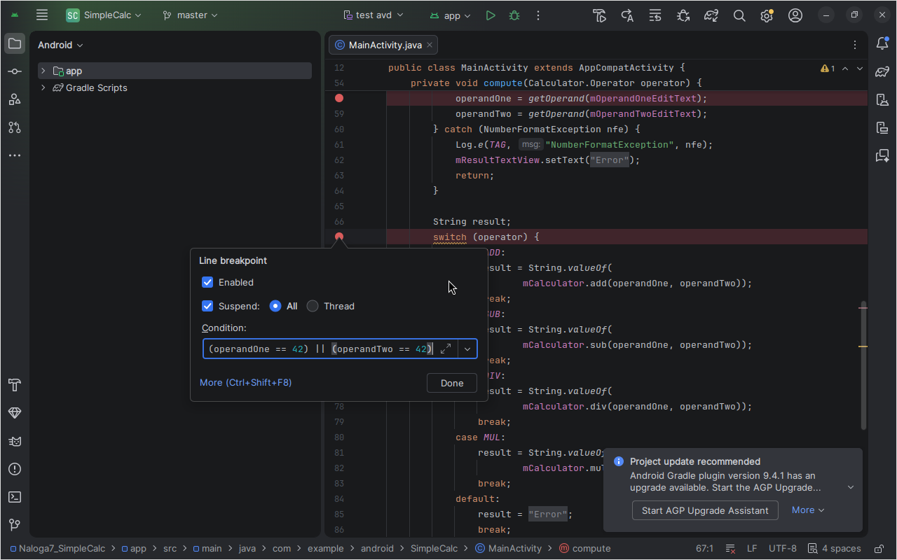
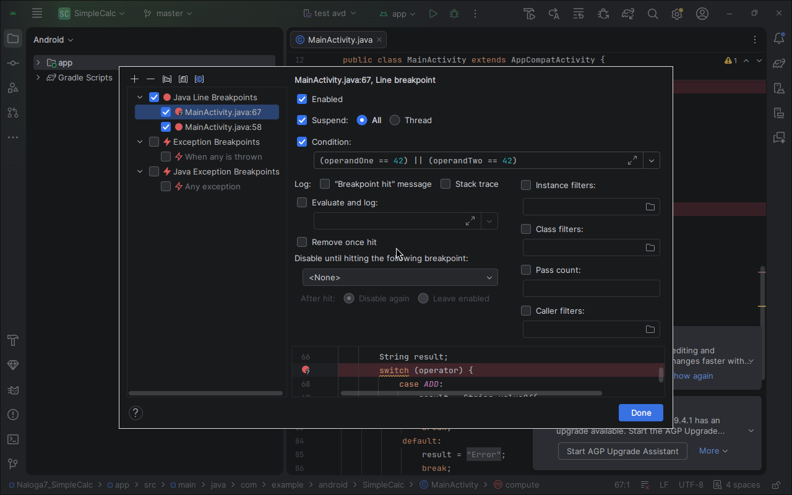
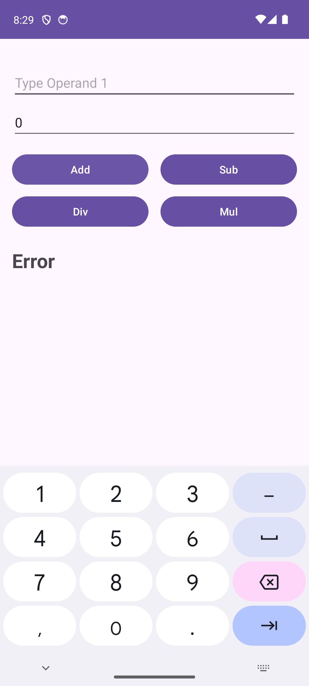
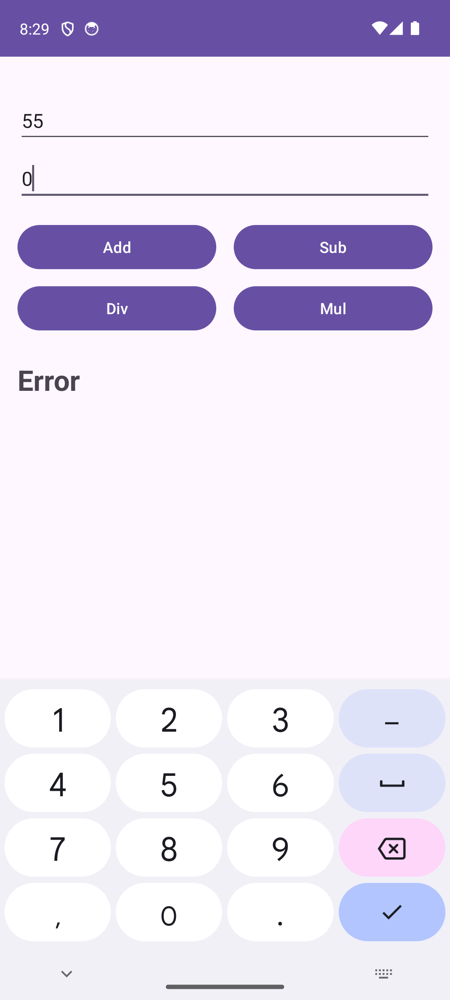

# Poročilo o vaji: Razhroščevanje aplikacij v Android Studiu (SimpleCalc)

**Predmet**: Mobilne Aplikacije (MOAp)  
**Projekt**: SimpleCalc (Naloga 7)  
**Okolje**: Android Studio, Android SDK 36 (Android 16), AVD Emulator (Pixel 7, API 34), Java 17  

---

## 1. Pregled projekta, vmesnika in poteka izračuna

Aplikacija SimpleCalc ponuja enostaven uporabniški vmesnik z dvema vnosnima poljema `EditText` za vnos številskih operandov, štirimi gumbi za računske operacije (ADD, SUB, DIV, MUL) ter poljem `TextView` za prikaz rezultata izračuna.

Klik na posamezen gumb sproži pripadajočo `onClick` metodo v `MainActivity.java`:
- `onAdd(View view)` -> `compute(Calculator.Operator.ADD)`
- `onSub(View view)` -> `compute(Calculator.Operator.SUB)`
- `onDiv(View view)` -> `compute(Calculator.Operator.DIV)`
- `onMul(View view)` -> `compute(Calculator.Operator.MUL)`

Vse operacije se stekajo v osrednjo metodo `compute()`, ki prek pomožnih metod `getOperand()` in `getOperandText()` prebere niz iz gradnika `EditText` ter ga s klicem `Double.valueOf()` pretvori v število tipa `double`. Dejanski izračun nato opravi primerek razreda `Calculator`.

### Tabela 1: Začetni preizkusi delovanja (pred popravki)

| Preizkus | Pričakovano | Opazovano (začetno stanje) | Opomba |
|---|---|---|---|
| **55 in 25, ADD** | 80 | 80.0 | Pravilen izračun seštevanja |
| **55 in 25, SUB** | 30 | 30.0 | Pravilen izračun odštevanja |
| **55 in 25, DIV** | 2.2 | 2.2 | Pravilen izračun deljenja |
| **55 in 25, MUL** | 1375 | 1375.0 | Pravilen izračun množenja |
| **Deljenje z 0 (55 in 0)** | Opozorilo / Napaka | `Infinity` | Java pri tipu `double` deljenje z 0 izvede po standardu IEEE 754 in vrne neskončnost namesto izjeme |
| **Deljenje 0 z 0 (0 in 0)** | Opozorilo / Napaka | `NaN` | Deljenje ničle z ničlo vrne `NaN` (Not a Number) |
| **Prazen vnos** | Opozorilo o praznem polju | `Error` | V Logcat se izpiše `NumberFormatException: empty String` |

> **Vprašanje**: Katera metoda pretvori besedilo iz `EditText` v število? Kje bi lahko nastala izjema pri praznem polju?  
> **Ugotovitev**: Besedilo v število pretvori metoda `Double.valueOf(operandText)` (znotraj pomožne metode `getOperand()`). Izjema `NumberFormatException` nastane v metodi `Double.valueOf()`, ko je vnosno polje prazno (vhodni niz je prazen `""`), saj prazen niz ne vsebuje števk in ga ni mogoče pretvoriti v število.

---

## 2. Zagon aplikacije v načinu Debug in prva prekinitvena točka

V razredu `MainActivity.java` v metodi `compute()` je bila nastavljena prva prekinitvena točka (Line Breakpoint) na vrstici:
```java
operandOne = getOperand(mOperandOneEditText);
```
neposredno za začetkom bloka `try`.

Aplikacija je bila zagnana v načinu razhroščevanja (**Run > Debug app**). V vnosni polji sta bili vpisani vrednosti `55` in `25`, nato je bil pritisnjen gumb **ADD**.

### Opažanja v razhroščevalniku:
- Izvajanje se je takoj zaustavilo tik pred izvedbo izbrane vrstice.
- **Trenutna metoda**: `compute(Calculator.Operator operator)`
- **Ime niti**: `main@...` (glavna grafična nit aplikacije / UI thread)
- **Vrednost parametra `operator`**: `Calculator.Operator.ADD`
- **Objekt `this`**: vsebuje reference na `mOperandOneEditText`, `mOperandTwoEditText`, `mResultTextView` ter `mCalculator`.

### Dokazilo 1: Prekinitvena točka v urejevalniku


---

## 3. Izvajanje po korakih: Step Over, Step Into, Step Out

Pri zaustavljenem programu na vrstici 58 so bili preizkušeni ukazi za vodenje izvajanja po korakih:

1. **Step Over (F8)**: Razhroščevalnik je izvedel klic `getOperand(mOperandOneEditText)` na trenutni vrstici brez vstopa v podrobnosti pomožne metode. Spremenljivka `operandOne` v razdelku `Variables` je dobila vrednost `55.0`. Izvajanje se je pomaknilo na vrstico 59 (`operandTwo = getOperand(...)`).
2. **Step Into (F7)**: Na vrstici 59 je bil uporabljen `Step Into`. Izvajanje je nemudoma prešlo v metodo `getOperand(EditText operandEditText)` na vrstico 92. Z naslednjim `Step Into` je izvajanje vstopilo v metodo `getOperandText(EditText)` na vrstico 98.
3. **Frames (klicni sklad)**: V oknu `Frames` se je na vrh dodal okvir `getOperandText()`, pod njim `getOperand()`, pod njim `compute()` in nato klici ogrodja Android (`performClick()`, `onClick()`, `ActivityThread.main()`).
4. **Step Out (Shift+F8)**: Ukaz je izvedel preostanek metode `getOperandText()` in se vrnil v kličočo metodo `getOperand()`, nato pa še en `Step Out` nazaj v `compute()`.
5. **Prehod v Calculator**: Na vrstici stavka `switch (operator)` je bil pri veji `case ADD:` ponovno uporabljen `Step Into`, s čimer je razhroščevalnik vstopil v razred `Calculator.java` v metodo `add(double firstOperand, double secondOperand)`. Po pregledu operandov se je z ukazom `Step Out` izvajanje vrnilo v `compute()`.

### Tabela 2: Ukazi za korakanje skozi kodo

| Ukaz | Bližnjica | Kaj se zgodi? | Opažanje med izvajanjem |
|---|---|---|---|
| **Step Over** | `F8` | Izvede trenutno vrstico brez vstopa v klicane metode. | `operandOne` se napolni z `55.0`, naslednja vrstica postane aktivna. |
| **Step Into** | `F7` | Vstopi v metodo, ki se kliče na trenutni vrstici. | Prehod iz `compute()` v `getOperand()` in naprej v `Calculator.add()`. |
| **Step Out** | `Shift+F8` | Dokonča trenutno metodo in se ustavi takoj po vrnitvi v klicatelja. | Hitra vrnitev iz pomožnih metod nazaj na raven metode `compute()`. |
| **Resume Program** | `F9` | Nadaljuje normalno izvajanje do naslednje prekinitve. | Aplikacija izvede izračun in osveži prikaz rezultata na zaslonu. |

---

## 4. Prekinitvene točke in pogojno ustavljanje

Na vrstico stavka `switch (operator)` je bila dodana druga prekinitvena točka. V njenih lastnostih je bil nastavljen logični pogoj:
```java
(operandOne == 42) || (operandTwo == 42)
```

Prva prekinitvena točka na začetku metode `compute()` je bila začasno onemogočena (**Disable Breakpoint** - ikona postane neobarvana), s čimer se je preverilo izključno delovanje pogojnega ustavljanja.

### Tabela 3: Preizkus pogojnega ustavljanja

| Vnos (Operand 1 in Operand 2) | Ali se pogojna točka sproži? | Razlaga |
|---|---|---|
| **12 in 7** | **NE** | Noben operand ni enak 42; pogoj `(12 == 42) \|\| (7 == 42)` je `false`. |
| **42 in 7** | **DA** | Prvi operand je enak 42; leva stran pogoja je `true`, izvajanje se zaustavi na vrstici `switch`. |
| **7 in 42** | **DA** | Drugi operand je enak 42; desna stran pogoja je `true`, točka se sproži. |
| **7 in 8** | **NE** | Noben operand ni enak 42; pogoj je `false`. |

Preizkušena je bila tudi funkcija **Mute Breakpoints** (izklop vseh točk z enim klikom). Ko so prekinitvene točke utišane, aplikacija normalno računa brez prekinitev, ne da bi bilo treba točke brisati.

### Dokazilo 3: Pogojna prekinitvena točka in seznam točk
| Pogoj na prekinitveni točki | Seznam vseh prekinitvenih točk (View Breakpoints) |
|---|---|
|  |  |

---

## 5. Opazovanje in spreminjanje spremenljivk med izvajanjem

Med zaustavitvijo na pogojni prekinitveni točki pri vnosu `42` in `7` sta bili preučeni možnosti spremljanja in dinamičnega spreminjanja stanja pomnilnika:

1. **Ukaz Set Value (F2)**:
   - V oknu `Variables` je bila spremenljivka `operandOne` ročno spremenjena iz `42.0` na `10.0`.
   - Spremenljivka `operandTwo` je bila ročno spremenjena iz `7.0` na `10.0`.
   - V vnosnih poljih aplikacije je uporabnik še vedno videl vpisani vrednosti `42` in `7`.
   - Po pritisku **Resume Program** je aplikacija kot rezultat seštevanja (ADD) izpisala `20.0`!
   - **Pojasnilo**: Razhroščevalnik je neposredno prepisal vrednosti v pomnilniku (skladovnem okvirju), zato je kalkulator seštel novi vrednosti, ne glede na vsebino grafičnega gradnika.
2. **Ponavljanje za množenje (MUL)**:
   - Pri vnosu `42` in `7` sta bili vrednosti v razhroščevalniku spremenjeni na `3.0` in `3.0`.
   - Izpisan rezultat: `9.0` (namesto 294.0).
3. **Watches**:
   - V razdelek Watches so bili dodani izrazi `operandOne`, `operandTwo` ter `operandOne + operandTwo`, kar omogoča trajno spremljanje njihove vrednosti na vsakem koraku.

### Tabela 4: Vpliv spreminjanja spremenljivk na končni rezultat

| Operacija | Vnos v aplikaciji | Spremenjeno v Debug (Set Value) | Prikazan rezultat v aplikaciji |
|---|---|---|---|
| **ADD** | 42 in 7 | `operandOne = 10.0`, `operandTwo = 10.0` | **20.0** |
| **MUL** | 42 in 7 | `operandOne = 3.0`, `operandTwo = 3.0` | **9.0** |

---

## 6. Evaluate Expression in pregled objektov

Z bližnjico **Alt+F8** (Run > Evaluate Expression) je bilo odprto orodje za sprotno vrednotenje izrazov:

### Tabela 5: Vrednotenje izrazov v ustavljenem stanju

| Izraz | Rezultat | Pomen |
|---|---|---|
| `operandOne + operandTwo` | `49.0` (oziroma `20.0` po spremembi) | Izračun vsote trenutnih vrednosti spremenljivk v pomnilniku. |
| `operandOne * operandTwo` | `294.0` (oziroma `9.0` po spremembi) | Izračun zmnožka trenutnih vrednosti. |
| `operandOne == 42` | `true` (oziroma `false`, če je bila vrednost spremenjena) | Preverjanje enakosti pogoja. |
| `mOperandOneEditText.getHint()` | `"Type Operand 1"` | Branje besedila namiga iz grafičnega gradnika. |
| `mOperandOneEditText.getText().toString()` | `"42"` | Branje dejanskega niza, ki je trenutno vpisan v gradnik. |

> **Opozorilo glede metod s stranskimi učinki (Side-Effects)**:  
> Pri uporabi Evaluate Expression je potrebna previdnost pri klicanju metod, ki spreminjajo notranje stanje programa (npr. spreminjanje vrednosti števcev, brisanje elementov iz seznamov ali klicanje metod, ki sprožijo omrežno zahtevo ali zapis v bazo). Razhroščevalnik takšne izraze dejansko izvede v delujočem procesu, kar lahko privede do nepričakovanih napak ali popačenja podatkov v nadaljnjem teku programa.

---

## 7. Iskanje in odprava napake: Prazen vnos in Logcat

Pri zagonu aplikacije s praznim prvim vnosnim poljem in številom `25` v drugem ter pritiskom na gumb **ADD** je bila analizirana napaka.

### Izsek Logcat:
```text
11-21 20:29:26.064  2606  2606 E CalculatorActivity: NumberFormatException
11-21 20:29:26.064  2606  2606 E CalculatorActivity: java.lang.NumberFormatException: Operand cannot be empty!
11-21 20:29:26.064  2606  2606 E CalculatorActivity: 	at com.example.android.SimpleCalc.MainActivity.getOperandText(MainActivity.java:99)
11-21 20:29:26.064  2606  2606 E CalculatorActivity: 	at com.example.android.SimpleCalc.MainActivity.getOperand(MainActivity.java:92)
11-21 20:29:26.064  2606  2606 E CalculatorActivity: 	at com.example.android.SimpleCalc.MainActivity.compute(MainActivity.java:58)
11-21 20:29:26.064  2606  2606 E CalculatorActivity: 	at com.example.android.SimpleCalc.MainActivity.onAdd(MainActivity.java:34)
```

### Analiza vzroka in sledi klicev:
1. **Mesto nastanka**: Napaka nastane v metodi `getOperandText()`, ko ugotovimo, da je niz prazen (`TextUtils.isEmpty(operandText)`), oziroma v klicu `Double.valueOf("")`, ki ne more interpretirati praznega niza kot veljavnega decimalnega števila.
2. **Mesto obravnave**: Napaka se prestreže v kličoči metodi `compute()`, kjer blok `catch (NumberFormatException nfe)` prestreže izjemo, zapise napako v Logcat ter na vmesniku izpiše uporabniku prijazno opozorilo `Error`.
3. **Izvedeni popravek**: V metodi `getOperandText()` je bilo dodano preverjanje z `TextUtils.isEmpty(operandText)`, ki v primeru praznega vnosa sproži razumljivo izjemo z opisom `"Operand cannot be empty!"`. S tem je preprečeno sesutje aplikacije, uporabnik pa je prek zaslonskega besedila `Error` obveščen o neveljavnem vnosu.

### Zaslonski posnetek delovanja ob praznem vnosu:


---

## 8. Dodatna analiza: Deljenje z nič in decimalne vrednosti

### 8.1 Deljenje z nič
- **Začetno obnašanje**: Java pri deljenju števil s plavajočo vejico tipa `double` z `0.0` ne sproži `ArithmeticException` (kot bi to storila pri celih številih `int`), temveč skladno z IEEE 754 vrne `Double.POSITIVE_INFINITY` oziroma `Double.NaN` pri `0.0 / 0.0`.
- **Izvedeni popravek**: V razredu `Calculator.java` v metodi `div()` je bilo uveljavljeno preverjanje delitelja:
  ```java
  public double div(double firstOperand, double secondOperand) {
      if (secondOperand == 0) {
          throw new IllegalArgumentException("You cannot divide by zero");
      }
      return firstOperand / secondOperand;
  }
  ```
- **Povezava z vmesnikom**: V `MainActivity.java` metoda `onDiv()` ujame `IllegalArgumentException` in v `mResultTextView` prikaže `Error` namesto neskončnosti.

### Zaslonski posnetek deljenja z 0:


### 8.2 Decimalne vrednosti in natančnost plavajoče vejice
- Pri preizkusu vrednosti, kot sta `1.6753456` in `0.1`, je bilo opaziti značilnost dvojiške predstavitve števil s plavajočo vejico po standardu IEEE 754.
- Nekatera decimalna števila (kot je 0.1) v dvojiškem sistemu nimajo končnega zapisa (so periodična), kar pri zaporednih računskih operacijah lahko privede do drobnih zaokrožitvenih odstopanj na zadnjih decimalnih mestih.
- Zato se pri primerjavi decimalnih števil v enotnih testih nikoli ne uporablja stroge enakosti `==`, temveč se uporablja tolerančno območje (delta / epsilon, npr. `closeTo(expected, delta)`).

---

## 9. Enotno testiranje (Unit Testing) s frameworkom JUnit 4

Skladno s predstavitvijo **03.2 App testing.pptx** so bili za logiko kalkulatorja napisani lokalni enotni testi v razredu `CalculatorTest.java` pod `app/src/test/java/com/example/android/SimpleCalc/CalculatorTest.java`.

### Glavni gradniki JUnit 4 testov:
- `@RunWith(JUnit4.class)`: Določi zaganjalnik testov JUnit 4.
- `@Before public void setUp()`: Inicializira nov primerek razreda `Calculator` pred vsakim posameznim testom.
- `@Test`: Označi testno metodo.
- `assertThat(actual, is(equalTo(expected)))`: Preverjanje pravilnosti rezultata z uporabo Hamcrest ujemalnikov.
- `@Test(expected = IllegalArgumentException.class)`: Preverjanje, ali metoda ob deljenju z 0 pravilno sproži pričakovano izjemo.

Vsi testi so bili uspešno zagnani in potrjeni z ukazom `./gradlew test`.

---

## 10. Vprašanja za preverjanje znanja

1. **Kakšna je razlika med običajnim zagonom (Run) in zagonom v načinu Debug?**  
   Pri običajnem zagonu se aplikacija prevede in izvaja s polno hitrostjo brez možnosti nadzora nad kodo. V načinu Debug pa se na aplikacijo pripne razhroščevalnik, ki omogoča postavljanje prekinitvenih točk, korakanje skozi vrstice kode, pregled pomnilnika in spreminjanje spremenljivk.

2. **Kaj je prekinitvena točka in v katerem delu urejevalnika jo nastavite?**  
   Prekinitvena točka je označba, ki razhroščevalniku naroči zaustavitev izvajanja programa tik pred določeno vrstico. Nastavi se s klikom na levi rob urejevalnika (gutter) poleg izvedljive vrstice.

3. **Kateri ukaz uporabite, če želite vstopiti v getOperand(), in kateri, če je ne želite odpreti?**  
   Za vstop v metodo se uporabi **Step Into** (`F7`). Če je ne želimo odpreti in želimo le izvesti klic ter ostati v trenutni metodi, uporabimo **Step Over** (`F8`).

4. **Kaj prikazuje Frames in kako vam pomaga ugotoviti pot klicev do napake?**  
   Frames prikazuje klicni sklad (call stack) trenutne niti. Omogoča vpogled v celotno hierarhijo metod, ki so privedle do trenutnega mesta zaustavitve ali izjeme.

5. **Kaj prikazuje Variables in kaj omogoča Watches?**  
   Variables prikazuje lokalne spremenljivke in objekte, ki so trenutno v dosegu. Watches omogoča definiranje in trajno spremljanje poljubnih izrazov skozi celoten postopek razhroščevanja.

6. **Kako deluje pogoj (operandOne == 42) || (operandTwo == 42)?**  
   Pogoj vrne `true`, če ima vsaj ena od spremenljivk vrednost 42. Razhroščevalnik se na pogojni točki ustavi le takrat, ko je ta pogoj izpolnjen.

7. **Kako lahko med razhroščevanjem spremenite vrednost spremenljivke brez spremembe vhodnega polja?**  
   V razdelku Variables izberemo spremenljivko, pritisnemo `F2` (Set Value), vnesemo novo vrednost in pritisnemo Enter.

8. **Za kaj uporabite Evaluate Expression in kakšna je nevarnost klicanja metod s stranskimi učinki?**  
   Uporablja se za sprotno računanje in testiranje izrazov. Nevarnost metod s stranskimi učinki je, da trajno spremenijo stanje delujočega programa, kar lahko povzroči napake v nadaljevanju.

9. **Zakaj pretvorba praznega niza v število lahko povzroči NumberFormatException?**  
   Ker metoda `Double.valueOf()` pričakuje veljavne številske znake; prazen niz ne vsebuje nobene števke, zato pretvorba ni mogoča.

10. **Kakšno je vedenje deljenja z 0 pri tipu double in zakaj se lahko razlikuje od celoštevilskega deljenja?**  
    Celoštevilsko deljenje z 0 sproži `ArithmeticException`. Pri tipu `double` pa po standardu IEEE 754 deljenje z 0 vrne `Double.POSITIVE_INFINITY` ali `Double.NaN`, zato izjema ni samodejno sprožena.
