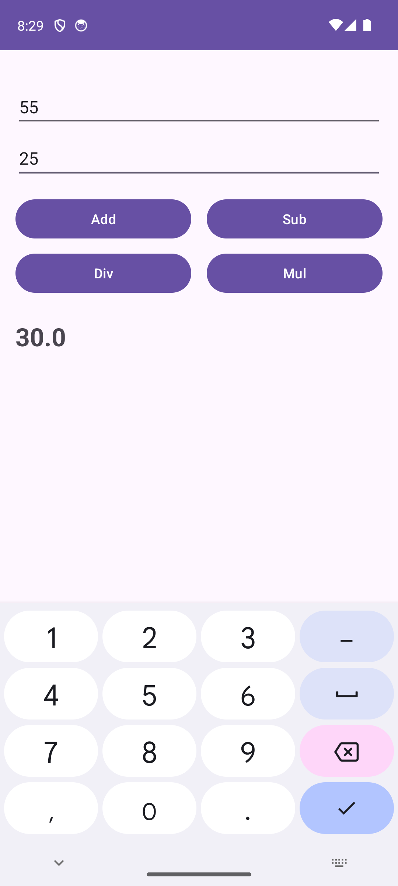
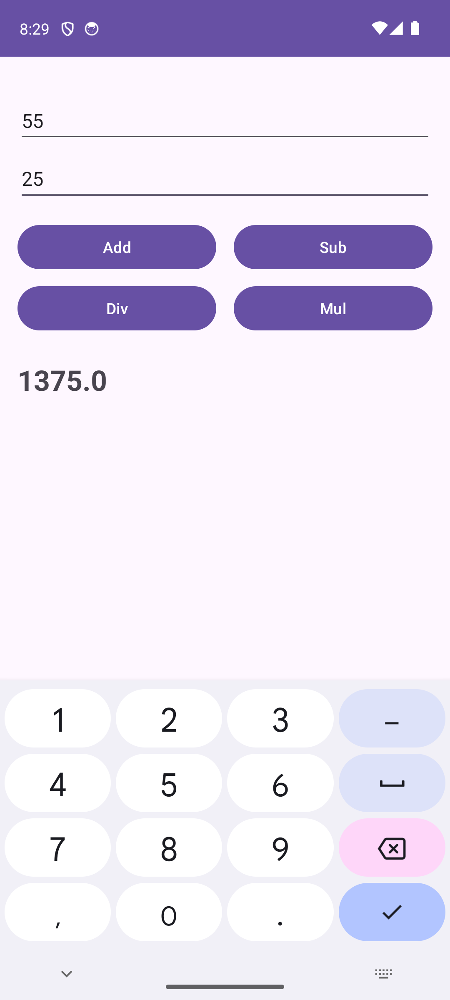
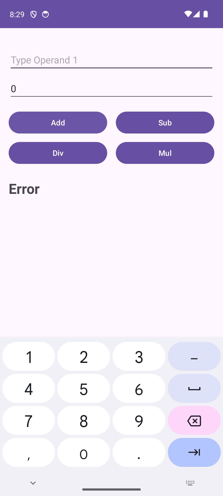

# SimpleCalc

Preprost kalkulator za dve števili, narejen pri predmetu MOAp. Pri nalogi smo z razhroščevalnikom v Android Studiu poiskali in popravili napake pri praznem vnosu in deljenju z nič.

## Delovanje

- V dve polji vpišeš števili in izbereš **Add**, **Sub**, **Div** ali **Mul**.
- Rezultat se izpiše pod gumbi.
- Če je polje prazno, aplikacija ne računa, ampak napiše, katero število manjka, in polje označi z rdečo ikono.
- Pri deljenju z nič izpiše `Cannot divide by zero`.

## Ikona

Ikona kalkulatorja na vijoličnem ozadju. Za zamenjavo uredi datoteke v `app/src/main/res/drawable/` (`ic_launcher_foreground.xml`, `ic_launcher_background.xml`) in `app/src/main/res/mipmap-*/ic_launcher.png`.

## Posnetki zaslona

| Začetni zaslon | 55 + 25 | 55 - 25 | 55 / 25 |
|---|---|---|---|
|  |  |  |  |

| 55 * 25 | 55 / 0 | Prazno polje |
|---|---|---|
|  |  |  |
